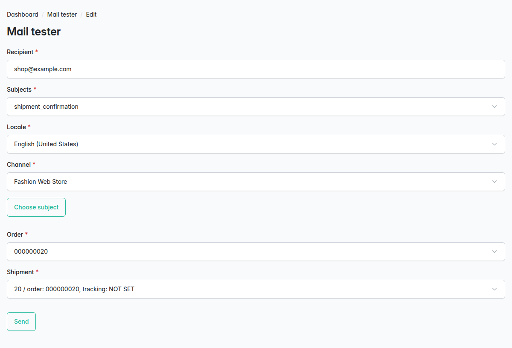

[](https://github.com/synolia/SyliusMailTesterPlugin/blob/main/LICENSE)
[](https://github.com/synolia/SyliusMailTesterPlugin/actions/workflows/analysis.yaml)
[](https://github.com/synolia/SyliusMailTesterPlugin/actions/workflows/sylius.yaml)
[](https://packagist.org/packages/synolia/sylius-mail-tester-plugin)
[](https://packagist.org/packages/synolia/sylius-mail-tester-plugin)

# Sylius Mail Tester Plugin

Check how your emails are rendered: send any Sylius email to your own mailbox from the admin panel, filled with real data from your store.




## Features

- **Every configured email** is listed: all the emails declared in `sylius_mailer`, including your own.
- **Real data**: pick the order, shipment, customer… used to render the template, plus the locale and the channel.
- **One email or all of them**: send the selected email, or every email at once.
- **Plugin emails** supported out of the box: [Refund Plugin](https://github.com/Sylius/RefundPlugin), [Invoicing Plugin](https://github.com/Sylius/InvoicingPlugin) (with the invoice attached) and Sylius Plus.
- **Extensible**: add a form type to send your custom emails with their variables.

## Requirements

|         | Version                                                  |
|:--------|:---------------------------------------------------------|
| PHP     | ^8.2 (8.4+ for Symfony 8)                                |
| Sylius  | ^2.0                                                     |
| Symfony | ^6.4 \|\| ^7.4 \|\| ^8.0 (Symfony 8 requires Sylius ^2.3) |

## Installation

1. Require the plugin:

    ```shell
    composer require synolia/sylius-mail-tester-plugin
    ```

2. Register the bundle in `config/bundles.php` if Symfony Flex did not do it:

    ```php
    Synolia\SyliusMailTesterPlugin\SynoliaSyliusMailTesterPlugin::class => ['all' => true],
    ```

3. Import the configuration in `config/packages/synolia_sylius_mail_tester.yaml`:

    ```yaml
    imports:
        - { resource: "@SynoliaSyliusMailTesterPlugin/config/config.yaml" }
    ```

4. Import the admin routes in `config/routes/synolia_sylius_mail_tester.yaml`:

    ```yaml
    synolia_mail_tester:
        resource: "@SynoliaSyliusMailTesterPlugin/config/routes/admin_routing.yaml"
        prefix: '/%sylius_admin.path_name%'
    ```

5. Clear the cache:

    ```shell
    php bin/console cache:clear
    ```

## Usage

1. In the admin panel, open **Configuration > Mail tester**.
2. Enter the email address that will receive the emails.
3. Select an email, or *All subjects* to send every email, then click **Choose subject**.
4. Fill in the fields and select the entities used to render the template.
5. Click **Send**.

## Sending your custom emails

To send a custom email with its variables, create a form type implementing `ResolvableFormTypeInterface`.
Each field of the form is a variable of the template. With autoconfiguration, the plugin discovers the form type automatically.

```php
<?php

declare(strict_types=1);

namespace App\Form\Type;

use Sylius\Component\Core\Model\Order;
use Symfony\Bridge\Doctrine\Form\Type\EntityType;
use Symfony\Component\Form\AbstractType;
use Symfony\Component\Form\FormBuilderInterface;
use Synolia\SyliusMailTesterPlugin\Resolver\ResolvableFormTypeInterface;

final class CustomEmailType extends AbstractType implements ResolvableFormTypeInterface
{
    // Code of the email in the sylius_mailer configuration
    private const SYLIUS_EMAIL_KEY = 'custom_email';

    public function buildForm(FormBuilderInterface $builder, array $options): void
    {
        // Renders the template with an "order" variable, chosen among the orders of the store
        $builder->add('order', EntityType::class, [
            'class' => Order::class,
            'choice_label' => 'number',
        ]);
    }

    public function support(string $emailKey): bool
    {
        return $emailKey === self::SYLIUS_EMAIL_KEY;
    }

    public function getCode(): string
    {
        return self::SYLIUS_EMAIL_KEY;
    }

    public function getFormType(string $emailKey): ResolvableFormTypeInterface
    {
        return $this;
    }
}
```

## Development

The plugin is developed and tested with the [Sylius Test Application](https://github.com/Sylius/TestApplication):

```shell
make install    # optionally: make install -e SYLIUS_VERSION=2.3.0 SYMFONY_VERSION=8.1
make phpunit
APP_ENV=test symfony server:start -d
```

Use `vendor/bin/console` to run Symfony commands against the test application.

See [How to contribute](CONTRIBUTING.md) for more details (database configuration, versions, ...).

## License

This plugin is released under the [MIT license](LICENSE).

## Credits

Developed by [Synolia](https://synolia.com/).
